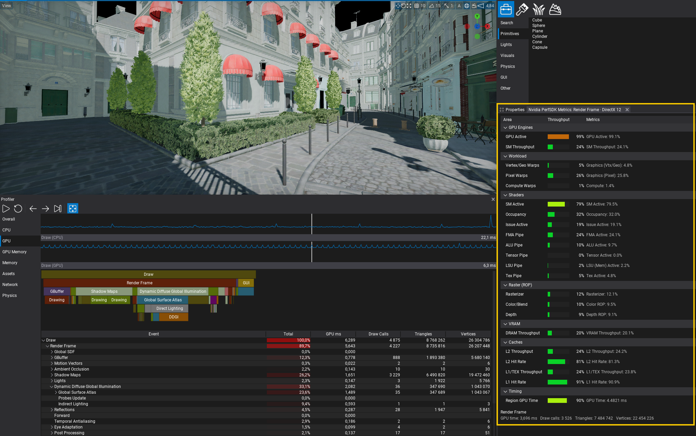

# PerfSDK Plugin

NVIDIA Nsight PerfSDK integration for the Flax Editor GPU Profiler. Double-click a GPU profiler region to open live chip counter metrics for that draw range.

## Features

- Live throughput bars and counter values grouped by GPU subsystem (SM, caches, VRAM, raster, etc.)
- **+ Add metric** — browse and add any supported NVPerf counter, ratio, or throughput metric at runtime
- Custom metrics appear under a **Custom** group; built-in defaults stay available
- Works while the scene is playing with the GPU profiler recording

## Requirements

- Windows x64 or Linux x64
- Flax 1.13+
- NVIDIA GPU + Nsight Perf SDK installed
- Environment variable **`NVPERF_SDK_PATH`** pointing at your Perf SDK root (e.g. `C:\Downloads\PerfSDK_2025_5` or `/opt/NVIDIA_Nsight_Perf_SDK`)

## Setup

1. Set `NVPERF_SDK_PATH` in your user or system environment.
2. On Linux, ensure the NvPerf host library directory is on the loader path. The plugin prepends `NvPerf/lib/a64` to `LD_LIBRARY_PATH` at runtime; you can also set it yourself before launching the editor.
3. Clone the plugin via the Editor [Plugin Window tool](https://docs.flaxengine.com/manual/scripting/plugins/plugin-project.html#automated-git-cloning), then reference it from your game project:

```
...
"References": [
    {
        "Name": "$(EnginePath)/Flax.flaxproj"
    },
    {
        "Name": "$(ProjectPath)/Plugins/PerfSDK/PerfSDK.flaxproj"
    }
]
```

4. Open the project and **Build & Run** (or **Tools → Recompile Scripts**) so the PerfSDK native module links against NVPerf. Check the Output Log for `Using PerfSDK v...` during compile.
5. Play the scene, open **Profiler → GPU**, enable live recording, then **double-click** a region to open the metrics window.

## Supported platforms

| Platform | Graphics APIs |
|----------|---------------|
| Windows x64 | DirectX 11, DirectX 12, Vulkan |
| Linux x64 | Vulkan only |

## Using the metrics window

1. Double-click a GPU profiler region — the **Nvidia PerfSDK Metrics** window opens for that range.
2. Click **+ Add metric** (toolbar or button) to open the picker.
3. Load available metrics, filter by name or type, and click a row to add it.
4. New metrics appear under **Custom** after the next sample collection cycle.

Status text at the top of the window shows session state (collecting passes, ready, errors). If profiling fails with `ERR_NVGPUCTRPERM`, enable GPU profiling permissions — see [NVIDIA ERR_NVGPUCTRPERM](https://developer.nvidia.com/ERR_NVGPUCTRPERM).

## API (C# / C++ game code)

To use PerfSDK types from your game scripts, import the module in `Game.Build.cs`:

```cs
public override void Setup(BuildOptions options)
{
    base.Setup(options);

    // Adds PerfSDK to PrivateDependencies when supported (Windows/Linux x64)
    PerfSDK.ConditionalImport(options, options.PrivateDependencies);
}
```

Game projects do not need this for the editor metrics UI — only if you call `RenderPerfTools` from your own code.

## Architecture

| Layer | Location |
|-------|----------|
| Native NVPerf + range profiler | `Source/PerfSDK/*.cpp` (plugin DLL) |
| Metrics editor window | `Source/PerfSDK/PerfSdkMetricsWindow.cs` |
| Add-metric picker | `Source/PerfSDK/PerfSdkAddMetricWindow.cs` |
| Editor plugin wiring | `Source/PerfSDK/PerfSDK.cs`, `GpuProfilerBridge.cs` |
| GPU frame hooks | `PerfSDK.cpp` via profiler callbacks |
| Profiler click plumbing | Engine `GpuProfilerRegionCallbacks` + GPU profiler UI |

All native NVPerf code lives in the plugin. The Flax engine does **not** define `COMPILE_WITH_RENDER_PERF` or link NVPerf — only the plugin does when `NVPERF_SDK_PATH` is set at build time.

## Vulkan note

PerfSDK requires extra Vulkan device extensions (`VK_EXT_buffer_device_address`, `VK_KHR_device_group`, plus NVPerf profiler extensions). The engine enables these at **device creation** when `NVPERF_SDK_PATH` is set **before starting the editor**.

1. Set `NVPERF_SDK_PATH` (and `VULKAN_SDK` for plugin builds).
2. **Fully close and reopen Flax Editor** so Vulkan device creation picks up the extensions.
3. Rebuild the engine (if you changed engine sources) and **Recompile Scripts**.
